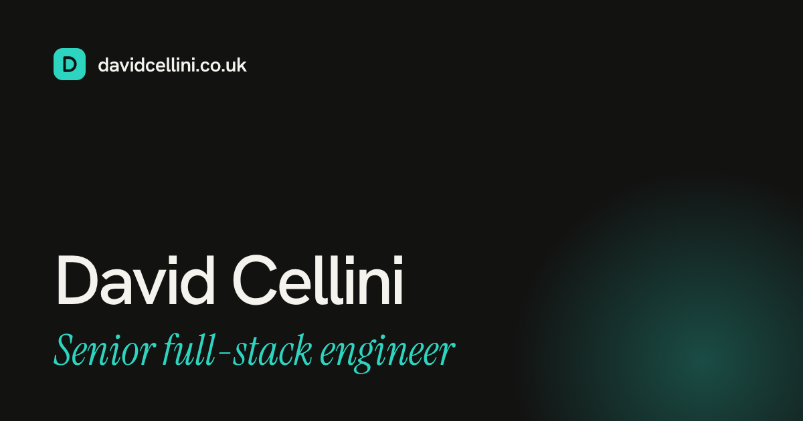

# davidcellini.co.uk

[](https://github.com/dcellini/portfolio-2026/actions/workflows/ci.yml)

The source for [davidcellini.co.uk](https://davidcellini.co.uk), the portfolio of David Cellini, a senior full-stack engineer in Newcastle upon Tyne.



The site is a single scrolling homepage plus a page for each case study, a resume page and a downloadable CV. It's a fully static [Astro](https://astro.build/) site on Cloudflare: no server, no database and no paid services. It's built on the [Maria theme](https://github.com/xocothemes/maria) by Andrei Alba, with a custom homepage, case study viewer and content model.

## What's on the site

- **Homepage:** hero, key facts, a career timeline, the case study viewer, more work, feedback from colleagues with a chart of recognitions per year, skills and contact.
- **Case studies** at `/work/<slug>/`: problem, what I did, a "How it works" diagram, the result and what colleagues said.
- **Resume** at `/resume/`: experience with exact dates, plus a PDF download of the CV.
- **Privacy** page and a designed 404.

## Built with

| Area      | Choice                                                          |
| --------- | --------------------------------------------------------------- |
| Framework | Astro 7, static output, MDX content collections                 |
| Styling   | Tailwind CSS 4, self-hosted Hanken Grotesk and Instrument Serif |
| Language  | TypeScript throughout, with Zod schemas for all content         |
| Hosting   | Cloudflare Workers static assets, deployed by Workers Builds    |
| Analytics | Cloudflare Web Analytics: cookieless, so no cookie banner       |
| Quality   | `astro check`, Prettier and Lighthouse CI in GitHub Actions     |

## Highlights

### Case study viewer

The homepage shows one case study at a time beside a list of the others, so visitors can read them without leaving the page (`src/components/home/CaseViewer.astro`).

- **Works without JavaScript.** Every list item is a real link to the full case study page. Script only enhances it.
- **No fetching.** Every panel is rendered into the HTML at build time from the same content collection, so switching is instant.
- **Shareable.** Choosing a case study updates the URL (`/?case=heatmaps`), opening that URL preselects it, and Back and Forward behave as expected.
- **Accessible.** The selected item has `aria-current`, arrow keys move through the list, focus moves to the new panel's heading, and transitions are off for anyone who prefers reduced motion.

### Typed content

All case studies live in `src/content/work/*.mdx`, validated by the schema in `src/content.config.ts`:

- `kind: full` entries appear in the viewer and need a headline figure, a diagram, 3–5 "In practice" points and a result.
- `kind: short` entries appear under "More work" and can link to a live demo or repo.
- `draft: true` keeps an entry out of every page and list.
- Quotes live in `src/data/quotes.json` and are attributed by role. A `name` is added only once that person has agreed to be named.

### Standards

- **Accessibility:** WCAG 2.2 AA throughout, with a skip link, visible focus, full keyboard use, 4.5:1 contrast in both light and dark themes, and reflow at 320 px. Lighthouse must score 100 for accessibility.
- **Performance:** static HTML, self-hosted fonts, responsive images through Astro's image tools, and JavaScript only for the viewer, the theme toggle and the menu.
- **Sharing and search:** a sitemap, `robots.txt`, canonical URLs, a title and description on every page, Open Graph and Twitter cards, and JSON-LD structured data.
- **Privacy:** no cookies and no third-party requests apart from the analytics beacon, which only loads on the live domain.

## Project structure

```text
src/
  components/
    chrome/       Header, footer and theme toggle
    home/         Homepage sections, including CaseViewer and RecognitionChart
    mdx/          Components available inside case studies (Figure, Stats)
    ui/           Shared pieces such as icons and section headings
    work/         Case study page parts (StepDiagram, NextProject)
  config/         Site settings, homepage and resume copy
  content/work/   One MDX file per case study
  data/           Career timeline, skills, quotes and recognition counts
  layouts/        Base layout with SEO, social and analytics tags
  lib/            Helpers for work entries, structured data and icons
  pages/          Routes: home, /work/[slug]/, /resume/, /privacy/, 404
public/           CV PDF, share image, fonts and favicon
scripts/          Share-image generator
```

## Getting started

Uses Node 24 (see `.nvmrc`).

```bash
npm install
npm run dev      # http://localhost:4321
```

| Command                 | What it does                                        |
| ----------------------- | --------------------------------------------------- |
| `npm run dev`           | Starts the dev server                               |
| `npm run build`         | Builds the static site into `dist/`                 |
| `npm run preview`       | Serves the built site locally                       |
| `npm run check`         | Type checks Astro and TypeScript files              |
| `npm run format`        | Formats everything with Prettier                    |
| `npm run release:check` | Type check, build and format check, as CI runs them |

## Updating content

| To change                              | Edit                                  |
| -------------------------------------- | ------------------------------------- |
| A case study                           | `src/content/work/<slug>.mdx`         |
| Quotes                                 | `src/data/quotes.json`                |
| Timeline and resume experience         | `src/data/career.ts`                  |
| Skills                                 | `src/data/skills.ts`                  |
| Hero, key facts and section titles     | `src/config/home.ts`                  |
| Name, links, email and analytics token | `src/config/site.ts`                  |
| The downloadable CV                    | Replace `public/david-cellini-cv.pdf` |

To add a case study, copy an existing MDX file, give it a new filename (which becomes its URL) and set `order` to place it. `npm run check` reports any missing or invalid fields.

### Share image

`public/og-image.png` is generated from `scripts/og-image.html`. After changing it, regenerate the PNG and bump the `?v=` number on `socialImage` in `src/config/site.ts`, so LinkedIn and other sites fetch the new version:

```bash
npm i -g playwright && npx playwright install chromium
NODE_PATH=$(npm root -g) node scripts/og-image.mjs
```

## CI

`.github/workflows/ci.yml` runs on every pull request and every push to `master`: `npm ci`, type check, format check and build, then [Lighthouse CI](https://github.com/GoogleChrome/lighthouse-ci) on the homepage and the Scheduled Surveys case study (`lighthouserc.json`). Each page is run three times, and the median must reach:

| Category       | Minimum |
| -------------- | ------- |
| Performance    | 90      |
| Best practices | 90      |
| SEO            | 95      |
| Accessibility  | 100     |

Reports are uploaded as a build artifact for seven days.

## Deploy

Cloudflare Workers Builds deploys every push to `master` to https://davidcellini.co.uk, serving `dist/` as static assets (`wrangler.jsonc`). Other branches get their own preview URLs, so changes can be checked before merging.

## Credits and licences

- [Maria theme](https://github.com/xocothemes/maria) by Andrei Alba, MIT licensed (see `LICENSE`).
- Fonts under the SIL Open Font License (`public/fonts/*/OFL.txt`).
- Icons from [Lucide](https://lucide.dev/) and [Bootstrap Icons](https://icons.getbootstrap.com/) (`src/icons/*/LICENSE*`).

The site's written content and case studies are © David Cellini.
